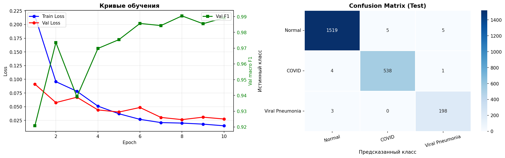
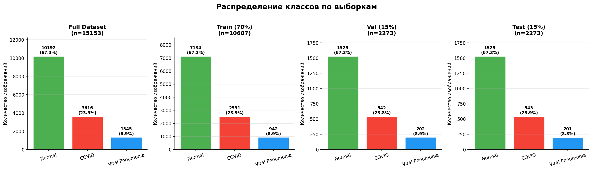

# Классификация рентгенограмм лёгких: Normal / COVID-19 / Viral Pneumonia

Модель компьютерного зрения, которая по рентгеновскому снимку грудной клетки определяет один из трёх классов: **здоровые лёгкие**, **COVID-19** или **вирусная пневмония**.

**Итог: macro avg F1 = 0.9877 на тестовой выборке** (целевой порог по заданию — 0.8). Выводы, анализ ошибок и ограничения: [conclusions.md](conclusions.md).



## Задача

- Датасет: рентгенограммы лёгких, 3 класса, 15 153 изображения ([скачать](https://drive.google.com/file/d/1zJklkBZA1gFbb4KLZaHld_BLf6iFKzGy/view?usp=sharing)).
- Разбить данные на train / val / test так, чтобы выборки сохраняли распределение классов исходного датасета.
- Обучить модель и посчитать на тесте Precision, Recall и F1 по каждому классу, а также macro avg.
- Цель: macro avg F1 ≥ 0.8.

## Данные

| Класс | Изображений | Доля |
|---|---:|---:|
| Normal | 10 192 | 67.3% |
| COVID | 3 616 | 23.9% |
| Viral Pneumonia | 1 345 | 8.9% |
| **Всего** | **15 153** | |

Классы сильно несбалансированы: вирусной пневмонии почти в 8 раз меньше, чем здоровых.

## Подход

1. **Стратифицированное разбиение 70 / 15 / 15** (`random_state=42`): доли классов сохраняются во всех выборках.

   | Выборка | Всего | Normal | COVID | Viral Pneumonia |
   |---|---:|---:|---:|---:|
   | Train | 10 607 | 7 134 | 2 531 | 942 |
   | Val | 2 273 | 1 529 | 542 | 202 |
   | Test | 2 273 | 1 529 | 543 | 201 |

   

2. **Предобработка:** resize 224×224, grayscale → 3 канала, нормализация под ImageNet.
3. **Аугментации (только train):** горизонтальный флип, поворот до 10°, яркость и контраст ±20%.
4. **Модель:** ResNet18, предобученная на ImageNet, заменён последний слой (`fc` → 3 класса), дообучаются все слои.
5. **Дисбаланс классов:** `CrossEntropyLoss` с весами, обратно пропорциональными размеру класса.
6. **Обучение:** Adam (lr = 1e-4), StepLR (каждые 3 эпохи ×0.5), batch 32, 10 эпох, устройство MPS (Apple Silicon). Лучшая эпоха выбирается по macro F1 на val: эпоха 8, val F1 = 0.9904.

## Результаты на тестовой выборке

| Класс | Precision | Recall | F1-score | Ошибок |
|---|---:|---:|---:|---:|
| Normal | 0.9954 | 0.9935 | 0.9944 | 10 / 1529 |
| COVID | 0.9908 | 0.9908 | 0.9908 | 5 / 543 |
| Viral Pneumonia | 0.9706 | 0.9851 | 0.9778 | 3 / 201 |
| **macro avg** | **0.9856** | **0.9898** | **0.9877** | |

Матрица ошибок (строки — истинный класс, столбцы — предсказание):

| | Normal | COVID | Viral Pneumonia |
|---|---:|---:|---:|
| **Normal** | 1519 | 5 | 5 |
| **COVID** | 4 | 538 | 1 |
| **Viral Pneumonia** | 3 | 0 | 198 |

## Выводы

Итоговое резюме, анализ ошибок, ограничения и следующие шаги: **[conclusions.md](conclusions.md)**.

## Как запустить

```bash
git clone <url-репозитория>
cd xray-covid-classification
python -m venv .venv && source .venv/bin/activate
pip install -r requirements.txt
```

1. Скачайте датасет по [ссылке](https://drive.google.com/file/d/1zJklkBZA1gFbb4KLZaHld_BLf6iFKzGy/view?usp=sharing) и распакуйте в корень проекта так, чтобы получилось:

   ```
   project_dataset/
   ├── Normal/images/*.png
   ├── COVID/images/*.png
   └── Viral Pneumonia/images/*.png
   ```
2. Откройте `notebooks/xray_classification.ipynb` и выполните ячейки по порядку. Ноутбук рассчитан на запуск из папки `notebooks/`: он читает данные из `../project_dataset/` и сохраняет графики в `../figures/`.
   Устройство выбирается автоматически (Apple MPS → CUDA → CPU). Лучшие веса сохраняются в `best_model.pth` (в репозиторий не коммитятся).

## Структура репозитория

```
.
├── README.md
├── conclusions.md                  # выводы, ограничения, дальнейшие шаги
├── requirements.txt
├── notebooks/
│   └── xray_classification.ipynb   # данные, обучение, метрики, выводы
└── figures/
    ├── class_distribution.png
    └── results.png
```

## Стек

Python · PyTorch · torchvision · scikit-learn · pandas · matplotlib · seaborn
